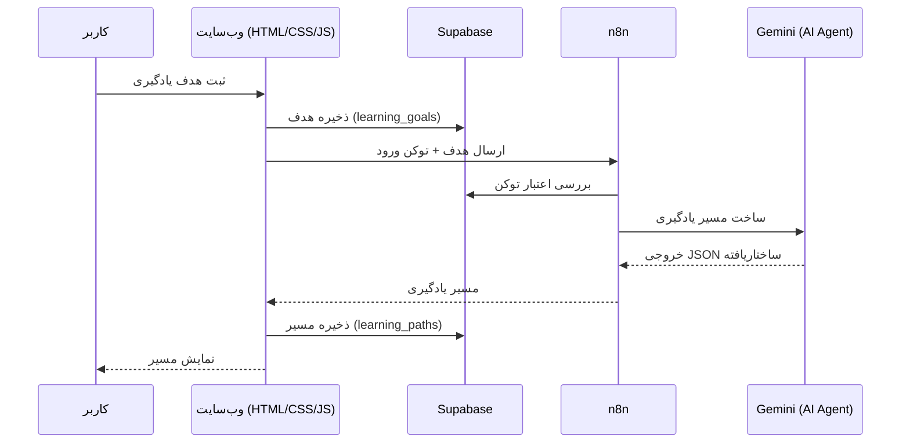

# LearnPath AI — طراح مسیر یادگیری با هوش مصنوعی

پروژه درس «مباحث ویژه ۲» (n8n + AI Agent).
کاربر ثبت‌نام می‌کند، هدف یادگیری‌اش را وارد می‌کند و یک **AI Agent در n8n** برایش مسیر یادگیری هفته‌به‌هفته می‌سازد.

## معماری



## فناوری‌ها

| بخش | ابزار |
|---|---|
| فرانت‌اند | HTML، CSS، JavaScript (فارسی و راست‌به‌چپ، فونت Vazirmatn) |
| ورود و دیتابیس | Supabase (Auth + PostgreSQL + RLS) |
| اتوماسیون و AI | n8n (Webhook + AI Agent + Structured Output Parser) |
| مدل زبانی | Google Gemini (قابل تعویض با OpenAI/OpenRouter در n8n) |

## ساختار پروژه

```
index.html               داشبورد (مسیر فعلی، آمار، اهداف و فعالیت‌های اخیر)
goals.html               اهداف من
paths.html               مسیرها، تیک پیشرفت، آزمون هفتگی و اصلاح برنامه
activity.html            تاریخچه فعالیت‌ها
auth.html                ورود و ثبت‌نام
forgot-password.html     درخواست بازیابی رمز
reset-password.html      تعیین رمز جدید
assets/css/              استایل هر صفحه
assets/js/               منطق هر صفحه + تنظیمات Supabase و n8n
n8n/learnpath-workflow.json   workflow آماده برای Import در n8n
supabase/schema.sql      ساخت جدول learning_paths و سیاست‌های امنیتی
SETUP.fa.md              راهنمای قدم‌به‌قدم راه‌اندازی
```

## راه‌اندازی

راهنمای کامل در [SETUP.fa.md](SETUP.fa.md) است.

## امنیت

- در کد مرورگر فقط کلید **publishable/anon** سوپابیس قرار دارد؛ امنیت داده‌ها با **Row Level Security** تأمین می‌شود.
- کلید Gemini/OpenAI فقط داخل n8n (Credentials) نگه‌داری می‌شود و هیچ‌وقت در GitHub قرار نمی‌گیرد.
- Webhook در n8n قبل از اجرای AI، توکن کاربر را با Supabase بررسی می‌کند تا فقط کاربران واردشده بتوانند مسیر بسازند.
- هرگز کلید `service_role` را داخل پروژه نگذارید.
